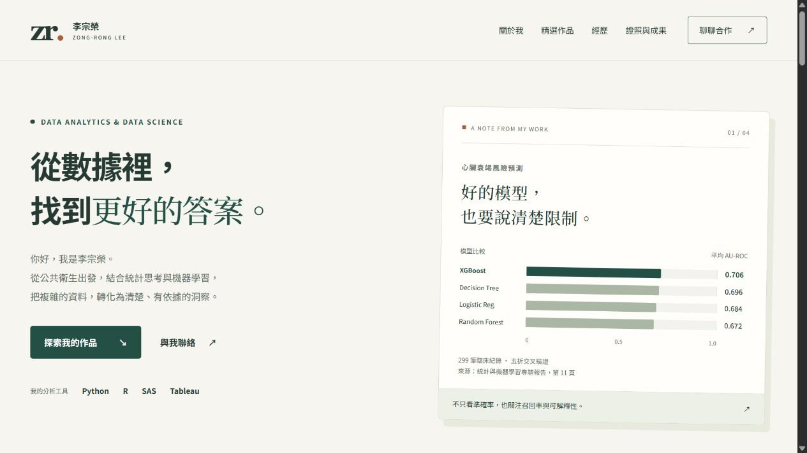

# 李宗榮｜資料分析與資料科學作品集

以繁體中文呈現個人介紹、專業技能、分析作品、實習經歷、研究成果與聯絡方式的響應式網站。使用原生 HTML、CSS 與 JavaScript，適合部署到 GitHub Pages，無須安裝前端套件或執行建置。

> 目前狀態：網站初版已於 2026-11-02 上線。正式頁面及 16 份 PDF 下載皆已驗證。

- GitHub 倉庫：[ericforai-17/ericforai-17.github.io](https://github.com/ericforai-17/ericforai-17.github.io)
- 公開網站：[ericforai-17.github.io](https://ericforai-17.github.io/)
- 聯絡 Email：[leezr34@gmail.com](mailto:leezr34@gmail.com)



## 網站內容

| 區塊 | 內容 |
| --- | --- |
| 首頁 | 個人定位、分析工具、以真實專題數值呈現的模型比較 |
| 關於我 | 公衛與流行病學背景、分析思維、三類專業技能 |
| 精選作品 | 心臟衰竭機器學習、長者活動軌跡、PM2.5 與心理健康、砷暴露與氣喘研究 |
| 經歷 | 國泰人壽、國衛院、高醫大數據研究中心、高雄市政府衛生局 |
| 證照與成果 | SAS、Azure AI Fundamentals、AI CUP、學術壁報、ISEE 與研習紀錄 |
| 聯絡方式 | Email、複製 Email、GitHub |

每個作品提供摘要、方法與成果說明，以及 PDF 閱讀／下載連結。共收錄 **4 件精選作品、5 份作品文件與 11 份證照／成果附件**。統計數值取自提供的報告，保留模型與研究設計的限制，沒有另行訓練模型或把研究成果描述為已上線產品。

## 技術與使用體驗

- **HTML5**：語意化區塊、單一主標題、原生 `details/summary` 摘要。
- **CSS3**：Grid、Flexbox、響應式斷點、系統字型，不依賴外部字型 CDN。
- **JavaScript**：作品類型篩選、行動版導覽、Email 複製與動態年份。
- **無障礙**：跳至主內容、鍵盤操作、焦點樣式、按鈕狀態、篩選結果播報、減少動態效果偏好。
- **漸進增強**：停用 JavaScript 時，內容、摘要、PDF 與 Email 連結仍可使用；篩選與複製按鈕不顯示。
- **隱私**：沒有追蹤碼、分析 Cookie、後端表單或第三方 API。聯絡按鈕透過使用者的郵件應用程式開啟。

## 專案結構

```text
.
├── .github/workflows/pages.yml   # 驗證網站並部署 site/ 至 GitHub Pages
├── .gitattributes
├── .gitignore                    # 排除根目錄原始 PDF 與本機暫存
├── README.md
├── docs/
│   ├── content-sources.md         # 公開資料來源與附件對照
│   ├── validation.md              # 初版驗證結果與範圍
│   └── preview.jpg                # 正式網站桌面預覽
├── scripts/
│   └── check_site.py              # 檢查連結、檔案與公開目錄範圍
└── site/                         # 唯一部署目錄
    ├── .nojekyll
    ├── index.html
    └── assets/
        ├── styles.css
        ├── main.js
        ├── favicon.svg
        └── documents/            # 16 份可公開下載的 PDF
```

專案根目錄的兩份原始履歷僅供本機整理內容，**不納入 Git、網站或部署成品**。作品文件與證明文件使用英文檔名複製到 `site/assets/documents/`，原始檔案保持不變。

## 本機預覽

需要 Python 3。於專案根目錄執行：

```sh
python -m http.server 8000 --bind 127.0.0.1 --directory site
```

開啟 [http://127.0.0.1:8000](http://127.0.0.1:8000)。按 `Ctrl+C` 停止伺服器。

若系統沒有 `python` 指令，可使用 Windows 的 `py`，或 Python 執行檔的完整路徑。只將 `site/` 設為伺服器根目錄，避免本機參考文件出現在預覽中。

也可以直接開啟 `site/index.html` 閱讀網站；剪貼簿功能需瀏覽器支援及安全環境（HTTPS 或 localhost），不支援時仍可點擊或手動複製 Email。

## 驗證方式

在專案根目錄執行，不需要額外 Python 套件：

```sh
python scripts/check_site.py
```

檢查內容包含站內連結、錨點、重複 ID、PDF 檔頭、16 份附件是否都有入口、必要區塊，以及原始履歷／不應公開的資料是否進入網站文字或檔名。這是靜態檢查，不能取代所有 PDF 內文及圖片的人工檢視。

若有 Node.js，可額外檢查 JavaScript 語法：

```sh
node --check site/assets/main.js
```

發布前請以桌面、平板與手機寬度檢查：

- 導覽、作品篩選、摘要開合、Email 與 PDF 連結正常。
- 行動版無水平捲動，選單可關閉，文字與按鈕不重疊。
- 鍵盤可操作互動元件，焦點清楚，停用 JavaScript 仍能閱讀。
- 公開目錄沒有原始履歷、家庭敘述或本機暫存資料。

本次已完成的檢查與瀏覽器測試範圍，見 [初版驗證紀錄](docs/validation.md)。

## GitHub Pages 部署

本專案已使用 GitHub Actions 完成部署。倉庫採 **Public**，名稱為 `ericforai-17.github.io`；往後推送 `main` 會先驗證再部署。以下保留首次設定步驟，方便重建環境：

1. 在 GitHub 建立上述空白倉庫，不額外產生 README 或其他起始檔案。
2. 若本機尚未初始化 Git，執行 `git init -b main`；以自己的 Git 使用者身分提交網站檔案。既有 Git 倉庫不要重複初始化。
3. 檢視 `git status`，確認根目錄原始 PDF 已被排除，再提交網站、文件與工作流程。
4. 設定 `origin` 為 `https://github.com/ericforai-17/ericforai-17.github.io.git`，推送 `main`。若已有 `origin`，先檢查其位置，避免覆蓋其他專案。
5. 至倉庫 **Settings → Pages → Build and deployment → Source** 選擇 **GitHub Actions**。
6. 至 **Actions → Deploy portfolio to GitHub Pages** 執行工作流程，或推送新的提交觸發部署。
7. 等待工作流程成功，開啟 Pages 顯示的公開網址，再將本 README 的狀態改為「已上線」。

工作流程先執行靜態檢查，再上傳 `site/`，不會將根目錄的參考文件或 README 發布為網站資源。Pull request 只驗證、不部署；`main` 推送或手動觸發才部署。

參考：[建立 GitHub Pages 網站](https://docs.github.com/en/pages/getting-started-with-github-pages/creating-a-github-pages-site)、[設定發布來源與自訂工作流程](https://docs.github.com/en/pages/getting-started-with-github-pages/configuring-a-publishing-source-for-your-github-pages-site)。

## 維護方式

- 修改介紹、經歷與作品：編輯 `site/index.html`。
- 修改色彩與排版：編輯 `site/assets/styles.css` 的 `:root` 與響應式區段。
- 修改互動：編輯 `site/assets/main.js`。
- 新增附件：只將確認可公開的文件放入 `site/assets/documents/`，同步更新網頁連結、`docs/content-sources.md` 與檢查腳本的附件數量。
- 新增作品：同步調整篩選按鈕數量、`data-category`、README 作品清單及檢查腳本的作品數量。
- 更換帳號／倉庫：更新 Git remote、網站 GitHub 連結與 README；站內相對路徑可支援專案型 Pages 子路徑。

### 提交紀錄原則

依實際完成的工作提交，例如：

```text
feat: build responsive data science portfolio
docs: document sources and local preview
ci: add validated GitHub Pages deployment
```

每次提交只包含有關聯的變更；提交前查看差異、執行檢查。保留真實開發順序，不虛構日期或為數量拆分無意義的提交。

## 作業驗收對照

| 驗收項目 | 對應內容／狀態 |
| --- | --- |
| 清晰自我介紹 | 首頁與關於我 |
| 專業技能標籤 | 技能區及各作品技術標籤 |
| 個人專案／經歷 | 4 件作品與 4 段經歷 |
| 聯絡管道 | Email、GitHub |
| RWD | 桌面、平板與手機響應式樣式 |
| 完整 README | 本文件 |
| Git 紀錄 | 已依網站、文件與 CI／部署分組提交並推送 |
| GitHub 倉庫連結 | 已建立公開倉庫，連結見文件開頭 |
| GitHub Pages 公開網址 | 已上線，正式首頁與 16 份 PDF 下載驗證通過 |

## 素材與權利

網站內容依本人提供的履歷、研究報告、獎狀與證照整理。附件內的機構名稱、標誌、研究內容與共同作者資訊，其權利屬原權利人；此處提供個人作品展示，不代表機構背書。沒有替附件授予額外的開源授權。

